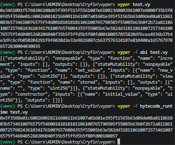

# First Vyper contract



## Setup

Create virtual env

```text
python -m venv venv
venv\Scripts\activate
```

```text
pip install vyper
```

```text
 pip freeze > requirements.txt
```

To create abi

```text
vyper -f abi test.vy
```

Runtime code

```text
vyper -f bytecode_runtime test.vy
```
